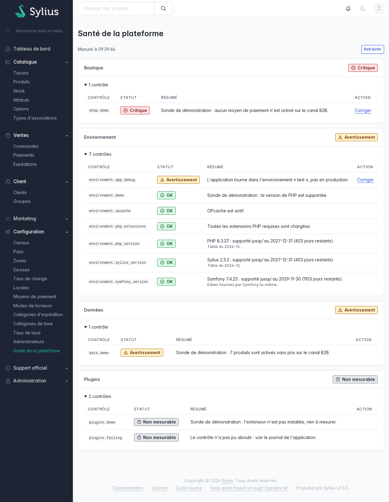
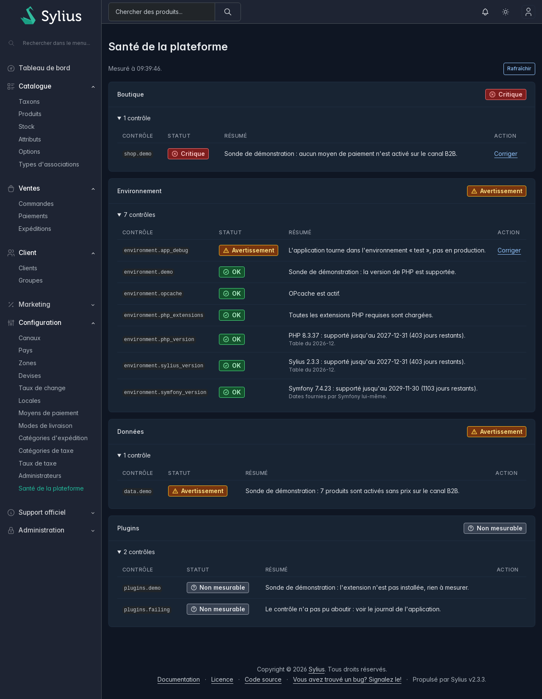
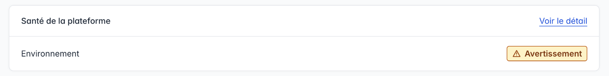
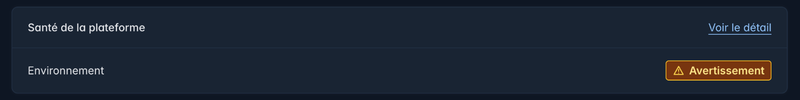

# Sylius Platform Health Plugin

> English: [README.md](README.md)

[](https://github.com/thibmonier/sylius-platform-health-plugin/actions/workflows/build.yaml)
[](LICENSE)

**Sylius 2 : un contrat de sonde que l'on implémente en quelques lignes, et un exécuteur qu'une sonde fautive ne peut pas casser.**

## État

Le plugin livre le **contrat, l'exécuteur, la page d'administration, un encart du tableau de bord, huit sondes d'environnement, sept sondes de données et un battement des tâches planifiées et une commande console (`tmonier:health:check`)** (versions et fin de support de PHP, Symfony et Sylius, extensions PHP, OPcache, mode debug, cache de l'application, dossiers inscriptibles ; connexion à la base, migrations en attente, dérive du schéma, croissance des tables, files Messenger, âge du plus ancien message, messages en échec ; commandes cron déclarées qui ne réussissent plus), ainsi qu'un rôle d'accès dédié et facultatif (`ROLE_PLATFORM_HEALTH_VIEW`). Les captures ci-dessous viennent de l'application de test : sa page liste aussi cinq sondes de démonstration qui vivent dans `tests/`, pas dans le paquet. Langues : français et anglais.

## La page d'administration

*Configuration > Santé de la plateforme* (`/admin/platform-health`, gardée par l'attribut `PLATFORM_HEALTH_VIEW`, voir [Contrôle d'accès](#contrôle-daccès)).





La page en anglais : [clair](docs/screenshots/platform-health-en-light.png), [sombre](docs/screenshots/platform-health-en-dark.png).

- **Synthèse par catégorie.** Chaque catégorie prend le pire statut de ses sondes (`critical`, `warning`, `unknown`, `ok`) : la catégorie qui contient une sonde critique passe en premier. Une sonde `unknown` s'affiche « Non mesurable » avec son motif court ; elle ne compte jamais comme critique, et ne laisse jamais une catégorie « OK ».
- **Détail par sonde, replié par défaut** : statut (toujours écrit en toutes lettres, jamais porté par la seule couleur), résumé, détail et **lien d'action** de la sonde, construit depuis le nom de route et les paramètres de son `HealthActionLink`. Une sonde qui pointe vers une route inexistante n'a pas de lien, pas d'erreur.
- **Rendu différé** (Live Component Symfony UX, `loading="defer"`) : la page répond tout de suite avec un squelette, les résultats arrivent juste après. Aucune sonde ne s'exécute pendant la construction du squelette.
- **Cache court mutualisé** : les résultats sont conservés `cache_ttl` secondes (60 par défaut, `0` désactive le cache) : trois administrateurs devant la page n'exécutent les sondes qu'une fois. Le bouton **Rafraîchir** les exécute à nouveau et remplace le cache.
- **Aucun contrôle installé** : la page le dit et renvoie à cette documentation, elle n'est ni vide ni en erreur.
- Une sonde défaillante ne casse jamais la page et le message de son exception n'est jamais affiché (il va au journal de l'application).

```yaml
# config/routes/tmonier_sylius_platform_health.yaml
tmonier_sylius_platform_health:
    resource: "@TmonierSyliusPlatformHealthPlugin/config/routes.yaml"
```

```yaml
# config/packages/tmonier_sylius_platform_health.yaml
tmonier_sylius_platform_health:
    time_budget_ms: 500   # par sonde
    cache_ttl: 60         # secondes mutualisées entre administrateurs, 0 désactive
    access:
        role: ROLE_ADMINISTRATION_ACCESS   # ROLE_PLATFORM_HEALTH_VIEW recommandé en production
```

L'entrée de menu et les hooks de la page sont enregistrés par le plugin lui-même, rien d'autre à importer.

## L'encart du tableau de bord

La première page après la connexion répond à « tout va bien ? » sans un clic : un encart compact **Santé de la plateforme** s'affiche sur le tableau de bord de l'administration, entre les statistiques et les dernières commandes.





Prises sur la démo B2B, avec ses vraies sondes : Symfony 8.1 approche de sa fin de support, d'où l'avertissement. L'encart en anglais : [clair](docs/screenshots/platform-health-dashboard-en-light.png), [sombre](docs/screenshots/platform-health-dashboard-en-dark.png).

- **Une ligne par catégorie**, la plus grave en premier, avec son pire statut **écrit en toutes lettres** (« OK », « Attention », « Critique », « Non mesurable ») et une icône propre : le statut n'est jamais porté par la seule couleur. Mêmes règles et mêmes jetons de couleur que la page, thèmes clair et sombre.
- **Le titre le dit** quand quelque chose est critique : « 1 catégorie critique », « 2 catégories critiques ». Sinon il affiche « Santé de la plateforme ». Un lien « Voir le détail » ouvre la page.
- **Le tableau de bord n'attend jamais une sonde.** L'encart est un Live Component différé qui lit le **même cache que la page** (`cache_ttl`) : le tableau de bord répond avec un squelette, puis l'encart se complète. Cache chaud : aucune sonde ne s'exécute ; cache froid : la première lecture alimente le cache de la page, après le rendu du tableau de bord.
- **Même droit que la page** : l'encart n'est rendu que pour un administrateur qui passe `PLATFORM_HEALTH_VIEW` (voir [Contrôle d'accès](#contrôle-daccès)), et l'URL de son composant répond 403 aux autres.
- **Un encart qui échoue disparaît sans bruit** : l'exception est journalisée avec sa trace, rien n'est affiché, le tableau de bord reste intact.
- Déclaré par le plugin via un Twig hook (`sylius_admin.dashboard.index.content`, dans `config/twig_hooks/admin.yaml`) : aucun gabarit de Sylius n'est surchargé, rien à configurer. Pour le retirer, mettez `enabled: false` sur l'entrée `platform_health` de ce hook dans votre propre configuration `sylius_twig_hooks`.

## Contrôle d'accès

**Par défaut, tout administrateur voit la page** (`access.role` vaut `ROLE_ADMINISTRATION_ACCESS`, le comportement de la v0.1.0 : une mise à jour ne casse rien). Un écran de diagnostic est une carte de l'installation (versions, chemins, états des files) : **en production, réglez `access.role` sur `ROLE_PLATFORM_HEALTH_VIEW`** et accordez-le administrateur par administrateur, avec la commande de Sylius lui-même :

```yaml
# config/packages/tmonier_sylius_platform_health.yaml
tmonier_sylius_platform_health:
    access:
        role: ROLE_PLATFORM_HEALTH_VIEW
```

```bash
bin/console sylius:user:promote admin@example.com ROLE_PLATFORM_HEALTH_VIEW --user-type=admin
```

L'administrateur se reconnecte pour porter le nouveau rôle. Le plugin ne fournit ni commande d'attribution ni `role_hierarchy` : il ne réécrit pas la sécurité de votre application (un rôle déclaré dans votre propre `role_hierarchy` est respecté). Une valeur qui n'est pas un rôle (elle doit commencer par `ROLE_`) fait échouer la compilation du conteneur.

Le garde est un *voter* de l'attribut `PLATFORM_HEALTH_VIEW`, posé sur la route de la page **et** sur la classe du Live Component (`#[IsGranted]`) : le composant est aussi servi sous `/admin/{_locale}/_components/...`, que l'administration ne protège qu'avec `ROLE_ADMINISTRATION_ACCESS`. Un administrateur sans le rôle reçoit un **403** sur la page, sur l'URL du composant et sur l'action de rafraîchissement, et l'entrée de menu est masquée.

### Valeurs sensibles et traces d'exécution

Les sondes sont écrites par des tiers : la page masque ce qu'une sonde laisse échapper, dans chaque résumé et détail (une sonde ne doit pourtant jamais produire de valeur sensible) :

| Trouvé dans un résumé ou un détail | Affiché |
|------------------------------------|---------|
| Identifiants d'un DSN (`mysql://shop:pass@db/sylius`) | `mysql://***@db/sylius` |
| Paires `secret`, `password`, `passwd`, `pwd`, `token`, `key`, `dsn` (`password=hunter2`, `API_KEY: abc`) | `password=***`, `API_KEY: ***` |
| Clé de 32 caractères ou plus contenant un chiffre | `***` |
| Chemin absolu dans le projet | chemin relatif au projet |
| Autre chemin absolu de fichier | `.../fichier.ext` |
| Trace d'exécution (`Stack trace:`, `#0 /chemin/File.php(12): ...`) | « Le détail a été masqué : voir le journal de l'application. », et la sonde est journalisée par son identifiant (jamais la trace) |

## Accessibilité

La page vise **WCAG 2.2 niveau AA** (la cible du thème de l'administration, pas AAA).

- **Un statut n'est jamais porté par la seule couleur** : chaque catégorie et chaque sonde l'écrit en toutes lettres (« OK », « Avertissement », « Critique », « Non mesurable ») à côté d'une icône dont la *forme* diffère selon le statut (coche, triangle, octogone, point d'interrogation). Les icônes sont décoratives (`aria-hidden`), le mot porte le sens.
- **Le détail est un vrai tableau** : `<caption>`, en-têtes `scope="col"`, un en-tête `scope="row"` par sonde, dans un `<details>`/`<summary>` natif (clavier et lecteur d'écran sans rien ajouter). Un lien d'action se lit « Corriger : <résumé de la sonde> », jamais « cliquer ici ».
- **Le rafraîchissement est annoncé** : une région `role="status"` (`aria-live="polite"`) dit « Résultats mis à jour » avec l'heure de la mesure, le focus reste sur le bouton **Rafraîchir**, et les résultats portent `aria-busy="true"` pendant le calcul (posé par le petit script de l'entrypoint admin du plugin). Le squelette de chargement respecte `prefers-reduced-motion`.
- **Thèmes clair et sombre** : les couleurs sont des variables CSS (`--tph-*`) qui suivent `data-bs-theme` de l'administration (Tabler), déclarées une fois dans `templates/admin/_tokens.html.twig` ; aucun gabarit ne porte de couleur. Chaque paire (texte sur fond, libellé sur pastille, icône sur pastille, bordure sur fond) est **mesurée** par `tests/Unit/Accessibility/StatusContrastTest.php`, qui échoue en nommant le jeton, le fond et le rapport trouvé quand un texte passe sous 4,5:1 ou une icône ou une bordure sous 3:1, dans les deux thèmes. Un jeton se change avec ce test.

Hors périmètre : AAA, droite à gauche, couleurs forcées au-delà d'un contrôle manuel. Les tests prouvent le balisage et le contraste ; un passage au lecteur d'écran reste un contrôle manuel.

## Sondes d'environnement

Huit sondes de la catégorie `environment`, enregistrées par le plugin lui-même (rien à déclarer), en lecture seule, **sans appel réseau**, sans jamais afficher la valeur d'une variable d'environnement. Chaque résultat qui n'est pas `ok` renvoie vers cette documentation (`Corriger`).

| Identifiant | Mesure | Statuts |
|---|---|---|
| `environment.php_version` | Version de PHP et fin du support de sécurité de sa branche | `ok` ; `warning` à moins de 180 jours de la fin ; `critical` le lendemain ; `unknown` pour une branche absente de la table |
| `environment.symfony_version` | `Kernel::END_OF_MAINTENANCE` et `Kernel::END_OF_LIFE`, fournies par Symfony lui-même (pas de table) | mêmes seuils ; `warning` une fois la maintenance terminée |
| `environment.sylius_version` | Version de Sylius et fin de support de sa branche mineure | comme PHP |
| `environment.php_extensions` | `intl`, `mbstring`, `ctype`, `iconv`, `xml`, `curl`, `pdo`, `gd` ou `imagick` | `ok` ; `critical` qui liste **seulement les manquantes** |
| `environment.opcache` | OPcache actif pour le SAPI qui sert la page | `ok` ; `warning` si inactif ; `unknown` si l'API est restreinte (`opcache.restrict_api`) |
| `environment.app_debug` | `kernel.debug` et `kernel.environment` | `ok` en prod sans debug ; `critical` avec debug en prod ; `warning` hors prod |
| `environment.cache_pool` | une clé témoin du plugin écrite, relue puis supprimée dans `cache.app` | `ok` ; `critical` si le cache la perd ou lève une exception (la cause, qui peut contenir le DSN du serveur de cache, n'est jamais affichée) |
| `environment.writable_dirs` | `var/cache`, `var/log` et `public/media` (ou son parent avant le premier envoi) inscriptibles par PHP | `ok` ; `critical` qui liste les dossiers par leur nom **relatif**, jamais le chemin absolu du serveur |

```yaml
# config/packages/tmonier_sylius_platform_health.yaml
tmonier_sylius_platform_health:
    environment:
        support_warning_days: 180   # les sondes PHP, Symfony et Sylius alertent ce nombre de jours avant la fin du support
```

**La table des fins de support** (`EndOfSupportTable`) est figée dans le code : l'administration n'appelle jamais le réseau. Sa version (`2026-12`) est affichée par les sondes PHP et Sylius (« Table du 2026-12 »). Elle est **renouvelée à chaque version du plugin** ; douze mois après sa version, ces deux sondes passent en `warning` (« table de dates à renouveler ») au lieu d'un faux `ok`. Une branche de PHP ou de Sylius absente de la table est `unknown` (« branche absente de la table »), jamais `ok`. Les sondes lisent la date par le service `clock` de Symfony : les tests injectent une horloge fixe.

## Sondes de données

Sept sondes de la catégorie `data`, enregistrées par le plugin (rien à déclarer), **en lecture seule** : aucune n'exécute de migration, ne modifie le schéma, ne compte les lignes d'une table, ni ne consomme, ne rejoue ou ne supprime un message Messenger. Seule la connexion Doctrine par défaut est sondée. Chaque résultat autre que `ok` renvoie à cette documentation (`Corriger`).

| Identifiant | Mesure | Statuts |
|---|---|---|
| `data.connection` | la connexion par défaut répond à une requête triviale (`SELECT 1`), et en combien de temps | `ok` avec la durée ; `warning` au-delà de 500 ms ; `critical` si la base ne répond pas (la cause va au journal, **jamais le DSN, l'hôte ni l'utilisateur** à l'écran) |
| `data.pending_migrations` | migrations Doctrine du code non exécutées, comme les rapporte `doctrine:migrations:status` | `ok` ; `critical` dès une migration en attente (lancer `bin/console doctrine:migrations:migrate`) ; `warning` pour une migration exécutée que le code ne connaît plus ; `unknown` sans migrations Doctrine |
| `data.schema_drift` | instructions qui aligneraient la base sur le mapping Doctrine (`doctrine:schema:update --dump-sql`) | `ok` ; `warning` avec le **nombre** d'instructions, jamais leur SQL (lancer `bin/console doctrine:schema:validate` pour les voir) ; `unknown` sans ORM Doctrine |
| `data.table_growth` | nombre de lignes **estimé** des tables **déclarées**, lu dans le catalogue de la base (MySQL et MariaDB : `information_schema.TABLES`, PostgreSQL : `pg_class`), **jamais de `COUNT(*)`** | `ok` sous le seuil ; `warning` au-delà ; `critical` au-delà du double ; `unknown` pour une table introuvable ou une autre base |
| `data.messenger_pending` | messages en attente de chaque transport Messenger qu'un worker consomme (transports d'échec, `sync://` et `in-memory://` mis à part) | `ok` ; `warning` qui nomme le transport le plus chargé au-delà de 100 messages ; `unknown` pour un transport qui ne sait pas compter |
| `data.messenger_oldest` | depuis combien de temps attend le plus ancien message, lu par `MIN(available_at)` dans la table d'un transport **Doctrine** | `ok` ; `warning` au-delà de 15 min ; `critical` au-delà d'1 h (aucun worker ne consomme la file) ; `unknown` sans transport Doctrine |
| `data.messenger_failed` | messages des transports d'échec, et transports qui n'en ont pas | `ok` ; `warning` dès un message en échec (critique au-delà de 100) ; `warning` qui nomme chaque transport **sans transport d'échec**, dont les messages en échec sont perdus |

```yaml
# config/packages/tmonier_sylius_platform_health.yaml
tmonier_sylius_platform_health:
    data:
        connection_warning_ms: 500      # data.connection alerte au-delà de ce temps de réponse
        messenger:
            pending_warning: 100        # messages en attente d'un transport à partir desquels data.messenger_pending alerte
            oldest_warning_minutes: 15  # âge du plus ancien message à partir duquel data.messenger_oldest alerte
            oldest_critical_minutes: 60 # et à partir duquel il est critique ; supérieur au seuil d'alerte
            failed_critical: 100        # messages en échec au-delà desquels data.messenger_failed est critique
        table_growth:                   # aucune table surveillée par défaut
            tmonier_audit_log: 100000   # lignes estimées à partir desquelles la table alerte (critique au-delà de 200000)
            sylius_order: 2000000
```

Déclarez les tables qu'une purge planifiée garde petites (journaux, historiques, messages envoyés) : quand la purge s'arrête, l'estimation dépasse son seuil. L'estimation est celle que la base tient pour son planificateur de requêtes ; elle suit le nombre réel avec du retard (PostgreSQL lit `0` pour une table jamais analysée), ce qui suffit pour un ordre de grandeur. Le calcul de la dérive du schéma charge tout le mapping : il tient dans le budget de temps de l'exécuteur avec le cache de métadonnées de production ; sinon, la sonde lit `unknown` (« budget de temps dépassé »), comme toute sonde lente.

## Battement des tâches planifiées

Un cron qui s'arrête n'écrit rien dans aucun journal. La sonde `scheduled_tasks.heartbeat` détecte **l'absence de succès** : chaque commande console déclarée enregistre la fin de ses exécutions, et la sonde compare le dernier succès au rythme déclaré.

```yaml
# config/packages/tmonier_sylius_platform_health.yaml
tmonier_sylius_platform_health:
    scheduled_tasks:
        heartbeats:                              # aucune commande surveillée par défaut
            'tmonier:feeds:generate': '15m'      # le rythme de son cron : « 30s », « 15m », « 1h », « 1d »
            'sylius:remove-expired-carts': '1d'
            'messenger:consume': '5m'
        warning_beats: 2                         # rythmes manqués au-delà desquels une commande alerte
        critical_beats: 4                        # et au-delà desquels elle est critique
```

Le rythme se déclare en configuration, jamais par un attribut sur la commande : la commande d'un autre plugin se surveille sans y toucher. Noms et rythmes sont validés à la compilation du conteneur.

**Enregistrement.** Un écouteur de `ConsoleEvents::TERMINATE` met à jour **une ligne par commande déclarée** dans la table `tmonier_platform_health_heartbeat` (premier enregistrement, dernier lancement, dernier code de sortie, dernier succès) ; une commande non déclarée n'est jamais enregistrée. La ligne est écrite par DBAL en fin de commande, jamais par l'entity manager : rien de ce que la commande a laissé sans `flush` n'est écrit avec elle. Une panne d'enregistrement va au journal ; **la commande garde son code de sortie**.

**La table** est la première entité du plugin. Sa migration est livrée avec le plugin (Sylius Labs migrations extra, après les migrations de Sylius) : lancer `bin/console doctrine:migrations:migrate` après la mise à jour.

| État d'une commande déclarée | Statut |
|---|---|
| dernier succès en moins de `warning_beats` rythmes | `ok`, avec l'heure du dernier succès |
| dernier lancement en échec (code de sortie non nul) | `warning` « dernier lancement en échec », avec le code |
| aucun succès depuis plus de `warning_beats` rythmes | `warning` |
| aucun succès depuis plus de `critical_beats` rythmes, ou lancements jamais réussis | `critical` |
| jamais lancée, enregistrement commencé il y a moins de `warning_beats` rythmes | `unknown` « pas encore de battement » |
| jamais lancée, alors que l'enregistrement a commencé avant | `warning` |
| table illisible (migration non lancée) | `unknown`, la cause au journal seulement |

La sonde prend la pire commande comme synthèse et donne une ligne par commande déclarée dans le détail. Elle ne fait que lire : aucune écriture pendant le rendu de la page. Le nom de la commande est affiché, jamais ses arguments ni sa sortie.

## La commande console

`php bin/console tmonier:health:check` lance les sondes depuis un shell, sans ouvrir l'administration. Elle passe par le même exécuteur que la page (même budget de temps par sonde, même masquage de ce qui est sensible) et **ne lit jamais le cache partagé avec la page** : un diagnostic en console est frais. Elle n'écrit rien.

```bash
php bin/console tmonier:health:check                                        # texte, regroupé par catégorie
php bin/console tmonier:health:check --format=json                          # JSON pour un script
php bin/console tmonier:health:check --category=data --category=shop        # répétable
php bin/console tmonier:health:check --only=data.connection --only=data.schema_drift
```

La sortie texte compte une ligne par sonde (statut écrit en toutes lettres, identifiant, résumé) sous le titre de sa catégorie, puis une ligne de synthèse. Les textes sont dans la locale par défaut de l'application. La sortie JSON est `{"status": "...", "generated_at": "...", "checks": [{"identifier", "category", "status", "summary"}]}` : valeurs brutes (`ok`, `warning`, `critical`, `unknown` ; `environment`, `data`, `scheduled_tasks`, `shop`, `plugins`), sans détail ni lien.

### Codes de sortie

Le code se calcule sur les sondes retenues par les filtres.

| Sondes retenues | Code |
|---|---|
| toutes `ok` | **0** |
| au moins une `warning`, aucune `critical` | **1** |
| au moins une `unknown`, aucune `critical` (une sonde qui ne mesure pas ne passe pas une porte de CI en silence) | **1** |
| au moins une `critical`, quelles que soient les autres | **2** |
| option invalide : `--category` inconnue, `--only` qui ne désigne aucune sonde, `--format` inconnu | **3**, avec un message qui nomme la valeur refusée |
| aucune sonde après des filtres valides (catégorie connue mais sans sonde) | **0**, avec le message « Aucun contrôle ne correspond à la sélection. » |

Le 3 est distinct du 2 à dessein : une faute de frappe dans un job de CI ne doit pas se lire comme « critique ». Une sonde qui lève une exception est `unknown` (donc 1) : l'exception va au journal de l'application, jamais à la sortie.

### Comme porte de CI après un déploiement

```bash
# tout code non nul fait échouer le job ; le 1 (warning, unknown) peut être toléré explicitement
php bin/console tmonier:health:check --format=json > health.json || [ $? -eq 1 ]
```

Pour n'échouer que sur `critical`, tolérer le 1 comme ci-dessus. Pour échouer sur tout ce qui n'est pas `ok`, retirer le `|| [ $? -eq 1 ]`.

### Dans un cron

```cron
*/15 * * * * cd /var/www/shop && php bin/console tmonier:health:check --category=data --category=scheduled_tasks > /dev/null || echo "Santé de la plateforme : code $?" | mail -s "Santé de la plateforme" ops@example.com
```

### Depuis la console de l'hébergeur

Sur un hébergeur qui ne donne qu'un shell, par exemple Railway :

```bash
railway ssh
php bin/console tmonier:health:check
```

## Exposer la santé en HTTP

Un point d'entrée public, `GET /health`, pour un outil de supervision ou le contrôle de santé d'un hébergeur. Il est **inactif tant qu'aucun jeton n'est configuré** (toute requête répond 404, comme une page absente) et il lit le résultat partagé avec la page (`cache_ttl`) : il ne lance jamais les sondes de lui-même.

```yaml
# config/packages/tmonier_sylius_platform_health.yaml
tmonier_sylius_platform_health:
    http:
        token: '%env(PLATFORM_HEALTH_TOKEN)%'            # niveau global
        detail_token: '%env(PLATFORM_HEALTH_DETAIL_TOKEN)%'  # niveau détail (facultatif, différent de token)
        liveness: false                                  # voir plus bas (défaut : false)
        rate_limit: 30                                   # requêtes par minute et par adresse IP (défaut : 30)
```

```yaml
# config/routes/tmonier_sylius_platform_health.yaml (les routes du plugin importent déjà /health)
tmonier_sylius_platform_health:
    resource: "@TmonierSyliusPlatformHealthPlugin/config/routes.yaml"
```

Pour servir ailleurs que sur `/health`, importez vous-même `config/routes/admin.yaml` (avec le préfixe de l'administration) et `config/routes/http.yaml` (avec votre préfixe) au lieu de `config/routes.yaml`.

| Requête | Réponse |
|---------|---------|
| aucun jeton configuré | 404 |
| sans en-tête, `liveness: false` | 404 |
| sans en-tête, `liveness: true` | 200 (aucune sonde `critical`) ou 503, corps vide |
| jeton faux, ou jeton dans l'URL | 404 |
| `Authorization: Bearer <token>` | 200 ou 503, `{"status", "generated_at"}` |
| `Authorization: Bearer <detail_token>` | 200 ou 503, plus `checks` (`identifier`, `category`, `status` de chaque sonde) |
| plus de `rate_limit` requêtes dans la minute depuis une IP | 429, rien n'est mesuré |

503 seulement si au moins une sonde est `critical` : un `warning` ou un `unknown` répond 200, le statut du corps les distingue.

```bash
curl -H "Authorization: Bearer $PLATFORM_HEALTH_TOKEN" https://boutique.example.com/health
```

### Sécurité

- Le jeton voyage dans l'en-tête `Authorization`, jamais dans l'URL (une URL finit dans les journaux et les référents), et se compare avec `hash_equals`. Utilisez des valeurs longues et aléatoires (`openssl rand -hex 32`) venant de l'environnement, jamais d'un fichier versionné.
- Une requête sans jeton valide reçoit le même 404 que n'importe quelle page absente : le point d'entrée ne révèle pas qu'il existe.
- Les réponses ne portent jamais de résumé, de détail, de lien, de version, de chemin, de nom de table ni de message d'exception : les résumés des sondes contiennent des versions et des noms de table, le niveau détail ne garde donc que l'identifiant, la catégorie et le statut. Les résumés se lisent sur la page d'administration ou avec la commande console.
- La limite compte chaque requête (les refusées aussi) par adresse IP, dans le cache de l'application. Derrière un reverse proxy, configurez `trusted_proxies` de Symfony, sinon toutes les requêtes semblent venir du proxy.
- Certaines installations PHP-FPM ou Apache suppriment l'en-tête `Authorization` : transmettez-le (`SetEnvIf Authorization ...` ou `fastcgi_param HTTP_AUTHORIZATION`).

### Contrôle de santé d'un hébergeur comme Railway

La documentation de Railway sur les contrôles de santé (https://docs.railway.com/deployments/healthchecks) ne mentionne aucun en-tête personnalisé : le contrôle est une requête simple sur le chemin configuré, envoyée avec le nom d'hôte `healthcheck.railway.app` (à autoriser si vous restreignez les hôtes), et toute réponse 2xx est saine. Il ne peut pas porter de jeton. Deux options :

- `liveness: true` : la requête sans en-tête reçoit 200 ou 503 avec un **corps vide** ; rien d'autre n'en ressort. Désactivé par défaut ; à n'activer que pour un tel contrôle.
- garder `liveness: false` et laisser un outil de supervision externe appeler `/health` avec le jeton.

### Différence avec un 503 sur migrations en attente

Une route de disponibilité qui répond 503 dès qu'une migration Doctrine est en attente (comme le `/healthz` de la démo B2B) n'est pas ce que fait ce point d'entrée : ici 503 signifie une sonde `critical`. `data.pending_migrations` est `critical` dès une migration en attente, mais les autres sondes `critical` comptent aussi et un `warning` ne compte jamais.

## Le contrat

```php
interface HealthCheckInterface
{
    public function identifier(): string;        // 'messenger.failed_transport'
    public function category(): HealthCategory;  // environment, data, scheduled_tasks, shop, plugins
    public function run(): HealthResult;
}
```

- `HealthStatus` : `ok`, `warning`, `critical`, `unknown`.
- `HealthResult` : un statut, un résumé d'une ligne traduisible, un détail traduisible facultatif, un lien d'action facultatif (`HealthActionLink` : un nom de route et ses paramètres, jamais une URL en dur).
- Découverte par **tag autoconfiguré** : un service dont la classe implémente `HealthCheckInterface` est enregistré sans une ligne de configuration.
- Le contrat et le `HealthCheckRunner` ne dépendent d'aucune classe Sylius (Symfony et PSR seulement) : une sonde se teste sans noyau Sylius.

## Votre propre sonde en quinze lignes

```php
final class PendingImportsCheck implements HealthCheckInterface
{
    public function __construct(private readonly ImportRepository $imports) {}

    public function identifier(): string { return 'imports.pending'; }

    public function category(): HealthCategory { return HealthCategory::Data; }

    public function run(): HealthResult
    {
        $pending = $this->imports->countPending();

        return $pending > 100
            ? HealthResult::warning(new TranslatableMessage('app.health.imports.backlog', ['%count%' => $pending]), action: new HealthActionLink('app_admin_import_index'))
            : HealthResult::ok(new TranslatableMessage('app.health.imports.ok'));
    }
}
```

Déclarez-la comme service avec l'autoconfiguration (le défaut d'une application Symfony) : c'est tout.

## Fournir une sonde depuis son plugin

Un plugin comme un outbox de webhooks peut fournir sa propre sonde **sans faire du plugin de santé une dépendance** : une boutique qui installe le plugin de webhooks n'obtient pas un écran de santé qu'elle n'a pas demandé, et la sonde apparaît dès que le plugin de santé est ajouté. Le motif tient en quatre éléments.

**1. `suggest` et `require-dev`, jamais `require`.** Le plugin de santé est suggéré à l'intégrateur et installé pour vos seuls tests :

```json
{
    "require": {
        "php": "^8.2",
        "sylius/sylius": "^2.2.9 || ^2.3"
    },
    "require-dev": {
        "tmonier/sylius-platform-health-plugin": "^0.5"
    },
    "suggest": {
        "tmonier/sylius-platform-health-plugin": "Affiche la sonde de santé de ce plugin sur la page et le tableau de bord d'administration"
    }
}
```

**2. Les sondes dans un fichier de services à part**, `config/health_checks.php`, séparé des autres services du plugin. L'autoconfiguration leur donne leur tag, ne les taguez jamais à la main :

```php
return static function (ContainerConfigurator $container): void {
    $container->services()
        ->set('acme_webhooks.health.outbox', OutboxCheck::class)
        ->autoconfigure()
    ;
};
```

**3. Une extension qui ne charge ce fichier que si l'interface existe.** `HealthCheckInterface::class` est une simple chaîne, elle ne charge pas l'interface : sans le plugin de santé, la classe de la sonde (qui l'implémente) n'est jamais chargée par l'autoloader, donc pas d'erreur fatale sur une interface absente. La vérification est un `\Closure` passé au constructeur, `interface_exists(...)` par défaut, pour qu'un test puisse répondre « absente » :

```php
final class AcmeWebhooksExtension extends Extension
{
    /** @var \Closure(string): bool */
    private readonly \Closure $interfaceExists;

    /**
     * @param (\Closure(string): bool)|null $interfaceExists
     */
    public function __construct(?\Closure $interfaceExists = null)
    {
        $this->interfaceExists = $interfaceExists ?? interface_exists(...);
    }

    public function load(array $configs, ContainerBuilder $container): void
    {
        (new PhpFileLoader($container, new FileLocator(__DIR__ . '/../../config')))->load('services.php');

        if (($this->interfaceExists)(HealthCheckInterface::class)) {
            (new PhpFileLoader($container, new FileLocator(__DIR__ . '/../../config')))->load('health_checks.php');
        }
    }
}
```

Le bundle reçoit le même closure facultatif et le transmet à son extension (l'application le construit sans argument, un test passe `static fn (string $interface): bool => false` pour jouer une boutique sans le plugin de santé) :

```php
final class AcmeWebhooksBundle extends Bundle
{
    /**
     * @param (\Closure(string): bool)|null $interfaceExists
     */
    public function __construct(private readonly ?\Closure $interfaceExists = null)
    {
    }

    protected function createContainerExtension(): ExtensionInterface
    {
        return new AcmeWebhooksExtension($this->interfaceExists);
    }
}
```


**4. La sonde**, comme dans la section précédente (`identifier()`, `category()`, `run()`), dans la catégorie `plugins` ou celle qui convient. Une sonde de votre plugin qui lève une exception est une sonde comme une autre : `unknown`, la cause journalisée, les autres sondes répondent.

Sans aucune sonde, une catégorie est **masquée** : ni sur la page ni dans l'encart du tableau de bord, jamais affichée vide ni en erreur.

Le dépôt applique ce motif dans son application de test : le plugin de démonstration dans `tests/Fixture/DemoWebhooks` (bundle, extension, `config/health_checks.php`, un `composer.json`), et `tests/Fixture/WithoutHealthPluginKernel.php`, un noyau qui le construit avec la vérification qui répond « absente ».

## Ce que l'exécuteur garantit

- **Aucune exception ne remonte à l'appelant.** Tout `\Throwable` est journalisé avec sa trace (contexte PSR-3 `exception`) et la sonde répond `unknown` avec un résumé générique : ni la trace ni le message brut ne sont affichés.
- **Budget de temps par sonde**, 500 ms par défaut (`tmonier_sylius_platform_health.time_budget_ms`). **Réserve :** PHP est synchrone, l'exécuteur ne peut pas interrompre une sonde en cours. Il mesure la durée *après* le retour de la sonde et, au-delà du budget, remplace le résultat par `unknown` (« budget de temps dépassé »). Les autres sondes répondent normalement. Une sonde qui fait des entrées-sorties doit donc appliquer son propre délai (délai de connexion, `timeout` du client HTTP, requête bornée).
- **Identifiants uniques, vérifiés à la compilation du conteneur** (donc au `cache:warmup`, en CI). Deux sondes de même identifiant font échouer la compilation, en nommant l'identifiant et les deux classes. Pour cela, `identifier()` doit rendre une constante et ne pas dépendre du constructeur.
- **Lecture seule.** Une sonde n'écrit rien et n'affiche aucun secret.

## Ce que le plugin n'est pas

- **Pas un APM** : ni agent, ni trace, ni profil. Pour cela, Sentry ou Blackfire.
- **Pas un agrégateur de logs** ni un collecteur de métriques continues : il mesure à l'instant où on le regarde.
- **Pas un scanner de sécurité** : il lira un rapport `composer audit` produit ailleurs, il ne scanne pas.
- **Aucune télémétrie sortante** : par défaut, aucune sonde n'appelle l'extérieur.

## Installation et tests

```bash
composer require tmonier/sylius-platform-health-plugin
```

Enregistrez `Tmonier\SyliusPlatformHealthPlugin\TmonierSyliusPlatformHealthPlugin` dans `config/bundles.php` et importez les routes (voir plus haut). Toutes les commandes de développement passent par Docker (`make install`, `make phpstan`, `make ecs`, `make rector`, `make unit`, `make non-unit`) ; la base est le MySQL de `sylius-b2b-demo`, dans une base au nom du plugin.

## Démo B2B

Ce plugin fait partie du travail présenté dans la [démo B2B Sylius](https://github.com/thibmonier/sylius-b2b-demo) : une boutique Sylius 2 avec des données d'exemple fictives, où les plugins B2B fonctionnent ensemble. La démo l'installe depuis la v0.2.0 : ses comptes administrateur publics ont le rôle `ROLE_PLATFORM_HEALTH_VIEW`, et la page montre les sondes de l'image réelle de la démo.

- Démo en ligne : [sylius-b2b.thibaut-monier.fr](https://sylius-b2b.thibaut-monier.fr)
- Auteur : [Thibaut Monier](https://www.linkedin.com/in/thibautmonier/)

## Licence

MIT.
