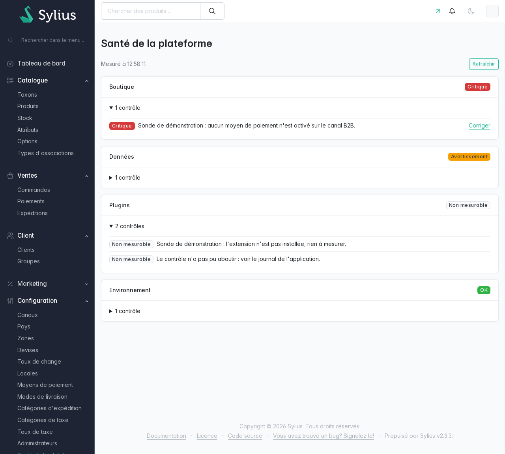

# Sylius Platform Health Plugin

> English: [README.md](README.md)

[](https://github.com/thibmonier/sylius-platform-health-plugin/actions/workflows/build.yaml)
[](LICENSE)

**Sylius 2 : un contrat de sonde que l'on implémente en quelques lignes, et un exécuteur qu'une sonde fautive ne peut pas casser.**

## État

Cette version livre le **contrat, l'exécuteur, la page d'administration et six sondes d'environnement** (versions et fin de support, extensions, OPcache, mode debug). La capture ci-dessous vient de l'application de test, avec cinq sondes de démonstration qui vivent dans `tests/`, pas dans le paquet.

## La page d'administration

*Configuration > Santé de la plateforme* (`/admin/platform-health`, protégée par le pare-feu d'administration de Sylius).



- **Synthèse par catégorie.** Chaque catégorie prend le pire statut de ses sondes (`critical`, `warning`, `unknown`, `ok`) : la catégorie qui contient une sonde critique passe en premier. Une sonde `unknown` s'affiche « Non mesurable » avec son motif court ; elle ne compte jamais comme critique, et ne laisse jamais une catégorie « OK ».
- **Détail par sonde, replié par défaut** : statut (toujours écrit en toutes lettres, jamais porté par la seule couleur), résumé, détail et **lien d'action** de la sonde, construit depuis le nom de route et les paramètres de son `HealthActionLink`. Une sonde qui pointe vers une route inexistante n'a pas de lien, pas d'erreur.
- **Rendu différé** (Live Component Symfony UX, `loading="defer"`) : la page répond tout de suite avec un squelette, les résultats arrivent juste après. Aucune sonde ne s'exécute pendant la construction du squelette.
- **Cache court mutualisé** : les résultats sont conservés `cache_ttl` secondes (60 par défaut, `0` désactive le cache) : trois administrateurs devant la page n'exécutent les sondes qu'une fois. Le bouton **Rafraîchir** les exécute à nouveau et remplace le cache.
- **Aucune sonde installée** : la page le dit et renvoie à cette documentation, elle n'est ni vide ni en erreur.
- Une sonde défaillante ne casse jamais la page et le message de son exception n'est jamais affiché (il va au journal de l'application).

```yaml
# config/routes/tmonier_sylius_platform_health.yaml
tmonier_sylius_platform_health:
    resource: "@TmonierSyliusPlatformHealthPlugin/config/routes.yaml"
```

```yaml
# config/packages/tmonier_sylius_platform_health.yaml
tmonier_sylius_platform_health:
    time_budget_ms: 500   # par sonde
    cache_ttl: 60         # secondes mutualisées entre administrateurs, 0 désactive
```

L'entrée de menu et les hooks de la page sont enregistrés par le plugin lui-même, rien d'autre à importer.

## Sondes d'environnement

Six sondes de la catégorie `environment`, enregistrées par le plugin lui-même (rien à déclarer), en lecture seule, **sans appel réseau**, sans jamais afficher la valeur d'une variable d'environnement. Chaque résultat qui n'est pas `ok` renvoie vers cette documentation (`Corriger`).

| Identifiant | Mesure | Statuts |
|---|---|---|
| `environment.php_version` | Version de PHP et fin du support de sécurité de sa branche | `ok` ; `warning` à moins de 180 jours de la fin ; `critical` le lendemain ; `unknown` pour une branche absente de la table |
| `environment.symfony_version` | `Kernel::END_OF_MAINTENANCE` et `Kernel::END_OF_LIFE`, fournies par Symfony lui-même (pas de table) | mêmes seuils ; `warning` une fois la maintenance terminée |
| `environment.sylius_version` | Version de Sylius et fin de support de sa branche mineure | comme PHP |
| `environment.php_extensions` | `intl`, `mbstring`, `ctype`, `iconv`, `xml`, `curl`, `pdo`, `gd` ou `imagick` | `ok` ; `critical` qui liste **seulement les manquantes** |
| `environment.opcache` | OPcache actif pour le SAPI qui sert la page | `ok` ; `warning` si inactif ; `unknown` si l'API est restreinte (`opcache.restrict_api`) |
| `environment.app_debug` | `kernel.debug` et `kernel.environment` | `ok` en prod sans debug ; `critical` avec debug en prod ; `warning` hors prod |

```yaml
# config/packages/tmonier_sylius_platform_health.yaml
tmonier_sylius_platform_health:
    environment:
        support_warning_days: 180   # les sondes PHP, Symfony et Sylius alertent ce nombre de jours avant la fin du support
```

**La table des fins de support** (`EndOfSupportTable`) est figée dans le code : l'administration n'appelle jamais le réseau. Sa version (`2026-12`) est affichée par les sondes PHP et Sylius (« Table du 2026-12 »). Elle est **renouvelée à chaque version du plugin** ; douze mois après sa version, ces deux sondes passent en `warning` (« table de dates à renouveler ») au lieu d'un faux `ok`. Une branche de PHP ou de Sylius absente de la table est `unknown` (« branche absente de la table »), jamais `ok`. Les sondes lisent la date par le service `clock` de Symfony : les tests injectent une horloge fixe.

## Le contrat

```php
interface HealthCheckInterface
{
    public function identifier(): string;        // 'messenger.failed_transport'
    public function category(): HealthCategory;  // environment, data, scheduled_tasks, shop, plugins
    public function run(): HealthResult;
}
```

- `HealthStatus` : `ok`, `warning`, `critical`, `unknown`.
- `HealthResult` : un statut, un résumé d'une ligne traduisible, un détail traduisible facultatif, un lien d'action facultatif (`HealthActionLink` : un nom de route et ses paramètres, jamais une URL en dur).
- Découverte par **tag autoconfiguré** : un service dont la classe implémente `HealthCheckInterface` est enregistré sans une ligne de configuration.
- Le contrat et le `HealthCheckRunner` ne dépendent d'aucune classe Sylius (Symfony et PSR seulement) : une sonde se teste sans noyau Sylius.

## Votre propre sonde en quinze lignes

```php
final class PendingImportsCheck implements HealthCheckInterface
{
    public function __construct(private readonly ImportRepository $imports) {}

    public function identifier(): string { return 'imports.pending'; }

    public function category(): HealthCategory { return HealthCategory::Data; }

    public function run(): HealthResult
    {
        $pending = $this->imports->countPending();

        return $pending > 100
            ? HealthResult::warning(new TranslatableMessage('app.health.imports.backlog', ['%count%' => $pending]), action: new HealthActionLink('app_admin_import_index'))
            : HealthResult::ok(new TranslatableMessage('app.health.imports.ok'));
    }
}
```

Déclarez-la comme service avec l'autoconfiguration (le défaut d'une application Symfony) : c'est tout.

## Ce que l'exécuteur garantit

- **Aucune exception ne remonte à l'appelant.** Tout `\Throwable` est journalisé avec sa trace (contexte PSR-3 `exception`) et la sonde répond `unknown` avec un résumé générique : ni la trace ni le message brut ne sont affichés.
- **Budget de temps par sonde**, 500 ms par défaut (`tmonier_sylius_platform_health.time_budget_ms`). **Réserve :** PHP est synchrone, l'exécuteur ne peut pas interrompre une sonde en cours. Il mesure la durée *après* le retour de la sonde et, au-delà du budget, remplace le résultat par `unknown` (« budget de temps dépassé »). Les autres sondes répondent normalement. Une sonde qui fait des entrées-sorties doit donc appliquer son propre délai (délai de connexion, `timeout` du client HTTP, requête bornée).
- **Identifiants uniques, vérifiés à la compilation du conteneur** (donc au `cache:warmup`, en CI). Deux sondes de même identifiant font échouer la compilation, en nommant l'identifiant et les deux classes. Pour cela, `identifier()` doit rendre une constante et ne pas dépendre du constructeur.
- **Lecture seule.** Une sonde n'écrit rien et n'affiche aucun secret.

## Ce que le plugin n'est pas

- **Pas un APM** : ni agent, ni trace, ni profil. Pour cela, Sentry ou Blackfire.
- **Pas un agrégateur de logs** ni un collecteur de métriques continues : il mesure à l'instant où on le regarde.
- **Pas un scanner de sécurité** : il lira un rapport `composer audit` produit ailleurs, il ne scanne pas.
- **Aucune télémétrie sortante** : par défaut, aucune sonde n'appelle l'extérieur.

## Installation et tests

```bash
composer require tmonier/sylius-platform-health-plugin
```

Enregistrez `Tmonier\SyliusPlatformHealthPlugin\TmonierSyliusPlatformHealthPlugin` dans `config/bundles.php` et importez les routes (voir plus haut). Toutes les commandes de développement passent par Docker (`make install`, `make phpstan`, `make ecs`, `make rector`, `make unit`, `make non-unit`) ; la base est le MySQL de `sylius-b2b-demo`, dans une base au nom du plugin.

## Licence

MIT.
