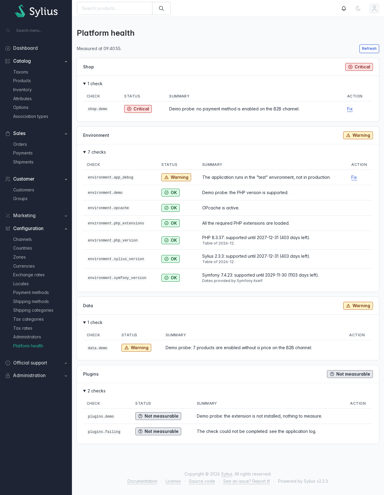
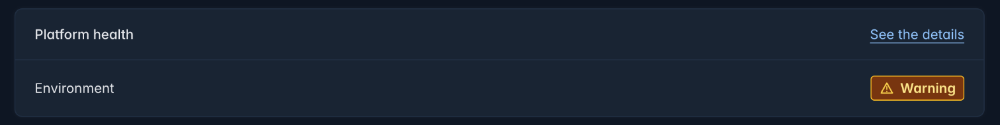

# Sylius Platform Health Plugin

> Français : [README.fr.md](README.fr.md)

[](https://github.com/thibmonier/sylius-platform-health-plugin/actions/workflows/build.yaml)
[](LICENSE)

**Sylius 2: a probe contract that you implement in a few lines, and a runner that a faulty probe can never break.**

## Status

The plugin ships the **contract, the runner, the administration page, a dashboard panel, six environment probes and four data probes** (PHP, Symfony and Sylius versions and end of support, PHP extensions, OPcache, debug mode; database connection, pending migrations, schema drift, table growth), plus a dedicated, optional access role (`ROLE_PLATFORM_HEALTH_VIEW`). The screenshots below come from the test application: its page also lists five demonstration probes that live in `tests/`, not in the package. Languages: English and French.

## The administration page

*Configuration > Platform health* (`/admin/platform-health`, guarded by the `PLATFORM_HEALTH_VIEW` attribute, see [Access control](#access-control)).




The French page: [light](docs/screenshots/platform-health-fr-light.png), [dark](docs/screenshots/platform-health-fr-dark.png).

- **Summary by category.** Each category takes the worst status of its probes (`critical`, `warning`, `unknown`, `ok`): the category that holds a critical probe comes first. An `unknown` probe reads "Not measurable" with its short reason; it never counts as critical, and never lets a category read "OK".
- **Detail by probe, folded by default**: status (always spelled out, never carried by colour alone), summary, detail and the **action link** of the probe, built from the route name and parameters of its `HealthActionLink`. A probe that points to a route that does not exist gets no link, not an error.
- **Deferred render** (Symfony UX Live Component, `loading="defer"`): the page answers at once with a skeleton, the results arrive right after. No probe runs while the skeleton is built.
- **Shared short cache**: the results are kept for `cache_ttl` seconds (60 by default, `0` disables the cache), so three administrators looking at the page run the probes once. The **Refresh** button runs them again and replaces the cache.
- **No check installed**: the page says so and points to this documentation, it is neither empty nor an error.
- A failing probe never breaks the page and its exception message is never displayed (it goes to the application log).

```yaml
# config/routes/tmonier_sylius_platform_health.yaml
tmonier_sylius_platform_health:
    resource: "@TmonierSyliusPlatformHealthPlugin/config/routes.yaml"
```

```yaml
# config/packages/tmonier_sylius_platform_health.yaml
tmonier_sylius_platform_health:
    time_budget_ms: 500   # per probe
    cache_ttl: 60         # seconds shared between administrators, 0 disables
    access:
        role: ROLE_ADMINISTRATION_ACCESS   # ROLE_PLATFORM_HEALTH_VIEW recommended in production
```

The menu entry and the page hooks are registered by the plugin itself, nothing else to import.

## The dashboard panel

The first page after the login answers "is everything fine?" without a click: a compact **Platform health** panel sits on the administration dashboard, between the statistics and the latest orders.




Taken on the B2B demo, with its real probes: Symfony 8.1 nears its end of support, hence the warning. The French panel: [light](docs/screenshots/platform-health-dashboard-fr-light.png), [dark](docs/screenshots/platform-health-dashboard-fr-dark.png).

- **One line per category**, the most severe first, with its worst status **spelled out** ("OK", "Warning", "Critical", "Not measurable") and an icon of its own: the status is never carried by colour alone. The same rules and the same colour tokens as the page, light and dark theme.
- **The title says it** when something is critical: "1 critical category", "2 critical categories". Otherwise it reads "Platform health". A "See the details" link opens the page.
- **The dashboard never waits for a probe.** The panel is a deferred Live Component that reads the **same cache as the page** (`cache_ttl`): the dashboard answers with a skeleton, then the panel completes. With a warm cache no probe runs; with a cold cache the first read feeds the cache for the page, after the dashboard has been rendered.
- **Same right as the page**: the panel is rendered only for an administrator who passes `PLATFORM_HEALTH_VIEW` (see [Access control](#access-control)), and its component URL answers 403 to the others.
- **A panel that fails disappears quietly**: the exception is logged with its trace, nothing is displayed, the dashboard stays intact.
- Registered by the plugin through a Twig hook (`sylius_admin.dashboard.index.content`, in `config/twig_hooks/admin.yaml`): no Sylius template is overridden, nothing to configure. To remove it, set `enabled: false` on the `platform_health` entry of that hook in your own `sylius_twig_hooks` configuration.

## Access control

**By default every administrator sees the page** (`access.role` is `ROLE_ADMINISTRATION_ACCESS`, the behaviour of v0.1.0, so an upgrade breaks nothing). A diagnostic screen is a map of the installation (versions, paths, states of queues): **in production, set `access.role` to `ROLE_PLATFORM_HEALTH_VIEW`** and grant it one administrator at a time, with the command of Sylius itself:

```yaml
# config/packages/tmonier_sylius_platform_health.yaml
tmonier_sylius_platform_health:
    access:
        role: ROLE_PLATFORM_HEALTH_VIEW
```

```bash
bin/console sylius:user:promote admin@example.com ROLE_PLATFORM_HEALTH_VIEW --user-type=admin
```

The administrator logs in again to carry the new role. The plugin ships no assignment command and no `role_hierarchy`: it does not rewrite the security of your application (a role you declared in your own `role_hierarchy` is honoured). A value that is not a role (it must start with `ROLE_`) fails the compilation of the container.

The guard is a voter for the `PLATFORM_HEALTH_VIEW` attribute, set on the route of the page **and** on the Live Component class (`#[IsGranted]`): the component is also served under `/admin/{_locale}/_components/...`, which the administration only protects with `ROLE_ADMINISTRATION_ACCESS`. An administrator without the role gets a **403** on the page, on the component URL and on the refresh action, and the menu entry is hidden.

### Sensitive values and execution traces

Probes are written by third parties, so the page masks what a probe lets slip, in every summary and detail (a probe should still never produce a sensitive value):

| Found in a summary or detail | Shown as |
|------------------------------|----------|
| DSN credentials (`mysql://shop:pass@db/sylius`) | `mysql://***@db/sylius` |
| `secret`, `password`, `passwd`, `pwd`, `token`, `key`, `dsn` pairs (`password=hunter2`, `API_KEY: abc`) | `password=***`, `API_KEY: ***` |
| 32+ character key containing a digit | `***` |
| Absolute path inside the project | path relative to the project |
| Other absolute file path | `.../file.ext` |
| Execution trace (`Stack trace:`, `#0 /path/File.php(12): ...`) | "The detail was hidden: see the application log.", and the probe is logged by its identifier (never the trace) |

## Accessibility

The page targets **WCAG 2.2 level AA** (the target of the administration theme, not AAA).

- **A status is never carried by colour alone**: each category and each probe spells it out ("OK", "Warning", "Critical", "Not measurable") next to an icon whose *shape* differs for each status (check, triangle, octagon, question mark). The icons are decorative (`aria-hidden`), the word carries the meaning.
- **The detail is a real table**: `<caption>`, `scope="col"` headers, one `scope="row"` header per probe, inside a native `<details>`/`<summary>` (keyboard and screen reader for free). An action link reads "Fix: <summary of the probe>", not "click here".
- **Refreshing is announced**: a `role="status"` region (`aria-live="polite"`) says "Results updated" with the time of the measure, the focus stays on the **Refresh** button, and the results carry `aria-busy="true"` while the probes run (set by the small script of the plugin's admin entrypoint). The loading skeleton honours `prefers-reduced-motion`.
- **Light and dark theme**: the colours are CSS variables (`--tph-*`) that follow `data-bs-theme` of the administration (Tabler), declared once in `templates/admin/_tokens.html.twig`; no template carries a colour. Every pair (text on surface, label on badge, icon on badge, border on surface) is **measured** by `tests/Unit/Accessibility/StatusContrastTest.php`, which fails with the token, the background and the ratio found when text drops under 4.5:1 or an icon or border under 3:1, in both themes. Change a token together with that test.

What is not covered: AAA, right-to-left, forced colours beyond a manual look. The tests prove the markup and the contrast; a screen reader pass remains a manual check.

## Environment probes

Six probes of the `environment` category, registered by the plugin itself (nothing to declare), read-only, **no network call**, no value of an environment variable ever displayed. Each non-`ok` result links to this documentation (`Fix`).

| Identifier | Measures | Statuses |
|---|---|---|
| `environment.php_version` | PHP version and end of security support of its branch | `ok`; `warning` within 180 days of the end; `critical` the day after; `unknown` for a branch absent from the table |
| `environment.symfony_version` | `Kernel::END_OF_MAINTENANCE` and `Kernel::END_OF_LIFE`, supplied by Symfony itself (no table) | same thresholds; `warning` once the maintenance has ended |
| `environment.sylius_version` | Sylius version and end of support of its minor branch | same as PHP |
| `environment.php_extensions` | `intl`, `mbstring`, `ctype`, `iconv`, `xml`, `curl`, `pdo`, `gd` or `imagick` | `ok`; `critical` listing **only the missing** extensions |
| `environment.opcache` | OPcache active for the SAPI that serves the page | `ok`; `warning` if inactive; `unknown` if the API is restricted (`opcache.restrict_api`) |
| `environment.app_debug` | `kernel.debug` and `kernel.environment` | `ok` in production without debug; `critical` with debug in production; `warning` outside production |

```yaml
# config/packages/tmonier_sylius_platform_health.yaml
tmonier_sylius_platform_health:
    environment:
        support_warning_days: 180   # PHP, Symfony and Sylius probes warn this many days before the end of support
```

**The end-of-support table** (`EndOfSupportTable`) is frozen in the code, so the administration never calls the network. Its version (`2026-12`) is displayed by the PHP and Sylius probes ("Table of 2026-12"). It is **renewed with every release of the plugin**; twelve months after its version, those two probes turn to `warning` ("dates table to renew") instead of a false `ok`. A PHP or Sylius branch absent from the table is `unknown` ("branch absent from the table"), never `ok`. The probes read the date through the Symfony `clock` service: tests inject a fixed clock.

## Data probes

Four probes of the `data` category, registered by the plugin (nothing to declare), **read-only**: none executes a migration, alters the schema or counts the rows of a table. Only the default Doctrine connection is probed. Each non-`ok` result links to this documentation (`Fix`).

| Identifier | Measures | Statuses |
|---|---|---|
| `data.connection` | the default connection answers a trivial query (`SELECT 1`), and how fast | `ok` with the duration; `warning` beyond 500 ms; `critical` when the database does not answer (the cause goes to the log, **never the DSN, the host or the user** to the screen) |
| `data.pending_migrations` | Doctrine migrations of the code not executed, as `doctrine:migrations:status` reports them | `ok`; `critical` from one pending migration (run `bin/console doctrine:migrations:migrate`); `warning` for an executed migration the code no longer knows; `unknown` without Doctrine migrations |
| `data.schema_drift` | statements that would align the database with the Doctrine mapping (`doctrine:schema:update --dump-sql`) | `ok`; `warning` with the **number** of statements, never their SQL (run `bin/console doctrine:schema:validate` to see them); `unknown` without a Doctrine ORM |
| `data.table_growth` | estimated rows of the **declared** tables, read from the catalogue of the database (MySQL and MariaDB: `information_schema.TABLES`, PostgreSQL: `pg_class`), **never a `COUNT(*)`** | `ok` under the threshold; `warning` beyond it; `critical` beyond the double; `unknown` for a missing table or another database |

```yaml
# config/packages/tmonier_sylius_platform_health.yaml
tmonier_sylius_platform_health:
    data:
        connection_warning_ms: 500      # data.connection warns beyond this answer time
        table_growth:                   # no table is watched by default
            tmonier_audit_log: 100000   # estimated rows from which the table warns (critical beyond 200000)
            sylius_order: 2000000
```

Declare the tables that a scheduled purge keeps small (logs, journals, sent messages): when the purge stops, the estimate grows past its threshold. The estimate is the one the database keeps for its query planner; it lags behind the real count (PostgreSQL reads `0` for a table never analysed), which is enough for an order of magnitude. Computing the schema drift loads the whole mapping: it fits in the time budget of the runner with the production metadata cache; if it does not, the probe reads `unknown` ("time budget exceeded"), like any slow probe.

## The contract

```php
interface HealthCheckInterface
{
    public function identifier(): string;        // 'messenger.failed_transport'
    public function category(): HealthCategory;  // environment, data, scheduled_tasks, shop, plugins
    public function run(): HealthResult;
}
```

- `HealthStatus`: `ok`, `warning`, `critical`, `unknown`.
- `HealthResult`: a status, a one-line translatable summary, an optional translatable detail, an optional action link (`HealthActionLink`: a route name and its parameters, never a hard-coded URL).
- Discovery by **autoconfigured tag**: a service whose class implements `HealthCheckInterface` is registered without a line of configuration.
- The contract and the `HealthCheckRunner` depend on no Sylius class (Symfony and PSR only): a probe is testable without a Sylius kernel.

## Your own probe in fifteen lines

```php
final class PendingImportsCheck implements HealthCheckInterface
{
    public function __construct(private readonly ImportRepository $imports) {}

    public function identifier(): string { return 'imports.pending'; }

    public function category(): HealthCategory { return HealthCategory::Data; }

    public function run(): HealthResult
    {
        $pending = $this->imports->countPending();

        return $pending > 100
            ? HealthResult::warning(new TranslatableMessage('app.health.imports.backlog', ['%count%' => $pending]), action: new HealthActionLink('app_admin_import_index'))
            : HealthResult::ok(new TranslatableMessage('app.health.imports.ok'));
    }
}
```

Declare it as a service with autoconfiguration (the default of a Symfony application): that is all.

## What the runner guarantees

- **An exception never reaches the caller.** Any `\Throwable` is logged with its trace (PSR-3 `exception` context) and the probe answers `unknown` with a generic summary: neither the trace nor the raw message is rendered.
- **Time budget per probe**, 500 ms by default (`tmonier_sylius_platform_health.time_budget_ms`). **Reserve:** PHP is synchronous, the runner cannot interrupt a probe that is running. It measures the duration *after* the probe returns and, over budget, replaces the result with `unknown` ("time budget exceeded"). The other probes still answer. A probe that does I/O must therefore apply its own timeout (connection timeout, HTTP client `timeout`, bounded query).
- **Unique identifiers, checked at container compilation** (so at `cache:warmup`, in CI). Two probes with the same identifier fail the compilation, naming the identifier and both classes. For that, `identifier()` must return a constant and not depend on the constructor.
- **Read-only.** A probe writes nothing and shows no secret.

## What the plugin is not

- **Not an APM**: no agent, no trace, no profile. Use Sentry or Blackfire for that.
- **Not a log aggregator** nor a continuous metrics collector: it measures at the moment you look.
- **Not a security scanner**: it will read a `composer audit` report produced elsewhere, it does not scan.
- **No outgoing telemetry**: by default no probe calls the outside world.

## Installation and tests

```bash
composer require tmonier/sylius-platform-health-plugin
```

Register `Tmonier\SyliusPlatformHealthPlugin\TmonierSyliusPlatformHealthPlugin` in `config/bundles.php` and import the routes (see above). Every development command runs in Docker (`make install`, `make phpstan`, `make ecs`, `make rector`, `make unit`, `make non-unit`); the database is the MySQL of `sylius-b2b-demo`, in a database named after the plugin.

## B2B demo

This plugin is part of the work shown in the [Sylius B2B demo](https://github.com/thibmonier/sylius-b2b-demo): a Sylius 2 shop with fictitious sample data where the B2B plugins work together. The demo installs it from v0.2.0: its public administrator accounts hold `ROLE_PLATFORM_HEALTH_VIEW`, so the page shows the probes of the real demo image.

- Online demo: [sylius-b2b.thibaut-monier.fr](https://sylius-b2b.thibaut-monier.fr)
- Author: [Thibaut Monier](https://www.linkedin.com/in/thibautmonier/)

## License

MIT.
