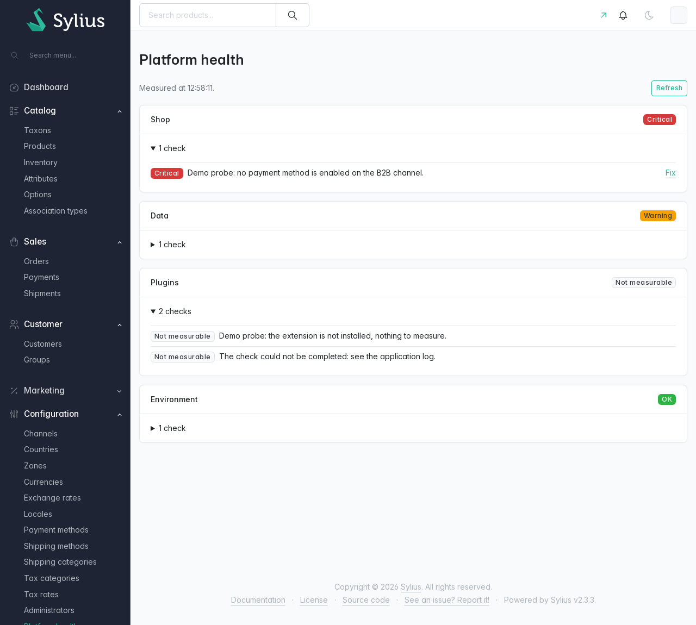

# Sylius Platform Health Plugin

> Français : [README.fr.md](README.fr.md)

[](https://github.com/thibmonier/sylius-platform-health-plugin/actions/workflows/build.yaml)
[](LICENSE)

**Sylius 2: a probe contract that you implement in a few lines, and a runner that a faulty probe can never break.**

## Status

This version ships the **contract, the runner and the administration page**. The plugin ships **no real probe yet**: the page shows the probes that your application (or another plugin) declares, and an explanation when there is none. The screenshot below comes from the test application, with five demonstration probes that live in `tests/`, not in the package.

## The administration page

*Configuration > Platform health* (`/admin/platform-health`, protected by the Sylius admin firewall).



- **Summary by category.** Each category takes the worst status of its probes (`critical`, `warning`, `unknown`, `ok`): the category that holds a critical probe comes first. An `unknown` probe reads "Not measurable" with its short reason; it never counts as critical, and never lets a category read "OK".
- **Detail by probe, folded by default**: status (always spelled out, never carried by colour alone), summary, detail and the **action link** of the probe, built from the route name and parameters of its `HealthActionLink`. A probe that points to a route that does not exist gets no link, not an error.
- **Deferred render** (Symfony UX Live Component, `loading="defer"`): the page answers at once with a skeleton, the results arrive right after. No probe runs while the skeleton is built.
- **Shared short cache**: the results are kept for `cache_ttl` seconds (60 by default, `0` disables the cache), so three administrators looking at the page run the probes once. The **Refresh** button runs them again and replaces the cache.
- **No probe installed**: the page says so and points to this documentation, it is neither empty nor an error.
- A failing probe never breaks the page and its exception message is never displayed (it goes to the application log).

```yaml
# config/routes/tmonier_sylius_platform_health.yaml
tmonier_sylius_platform_health:
    resource: "@TmonierSyliusPlatformHealthPlugin/config/routes.yaml"
```

```yaml
# config/packages/tmonier_sylius_platform_health.yaml
tmonier_sylius_platform_health:
    time_budget_ms: 500   # per probe
    cache_ttl: 60         # seconds shared between administrators, 0 disables
```

The menu entry and the page hooks are registered by the plugin itself, nothing else to import.

## The contract

```php
interface HealthCheckInterface
{
    public function identifier(): string;        // 'messenger.failed_transport'
    public function category(): HealthCategory;  // environment, data, scheduled_tasks, shop, plugins
    public function run(): HealthResult;
}
```

- `HealthStatus`: `ok`, `warning`, `critical`, `unknown`.
- `HealthResult`: a status, a one-line translatable summary, an optional translatable detail, an optional action link (`HealthActionLink`: a route name and its parameters, never a hard-coded URL).
- Discovery by **autoconfigured tag**: a service whose class implements `HealthCheckInterface` is registered without a line of configuration.
- The contract and the `HealthCheckRunner` depend on no Sylius class (Symfony and PSR only): a probe is testable without a Sylius kernel.

## Your own probe in fifteen lines

```php
final class PendingImportsCheck implements HealthCheckInterface
{
    public function __construct(private readonly ImportRepository $imports) {}

    public function identifier(): string { return 'imports.pending'; }

    public function category(): HealthCategory { return HealthCategory::Data; }

    public function run(): HealthResult
    {
        $pending = $this->imports->countPending();

        return $pending > 100
            ? HealthResult::warning(new TranslatableMessage('app.health.imports.backlog', ['%count%' => $pending]), action: new HealthActionLink('app_admin_import_index'))
            : HealthResult::ok(new TranslatableMessage('app.health.imports.ok'));
    }
}
```

Declare it as a service with autoconfiguration (the default of a Symfony application): that is all.

## What the runner guarantees

- **An exception never reaches the caller.** Any `\Throwable` is logged with its trace (PSR-3 `exception` context) and the probe answers `unknown` with a generic summary: neither the trace nor the raw message is rendered.
- **Time budget per probe**, 500 ms by default (`tmonier_sylius_platform_health.time_budget_ms`). **Reserve:** PHP is synchronous, the runner cannot interrupt a probe that is running. It measures the duration *after* the probe returns and, over budget, replaces the result with `unknown` ("time budget exceeded"). The other probes still answer. A probe that does I/O must therefore apply its own timeout (connection timeout, HTTP client `timeout`, bounded query).
- **Unique identifiers, checked at container compilation** (so at `cache:warmup`, in CI). Two probes with the same identifier fail the compilation, naming the identifier and both classes. For that, `identifier()` must return a constant and not depend on the constructor.
- **Read-only.** A probe writes nothing and shows no secret.

## What the plugin is not

- **Not an APM**: no agent, no trace, no profile. Use Sentry or Blackfire for that.
- **Not a log aggregator** nor a continuous metrics collector: it measures at the moment you look.
- **Not a security scanner**: it will read a `composer audit` report produced elsewhere, it does not scan.
- **No outgoing telemetry**: by default no probe calls the outside world.

## Installation and tests

```bash
composer require tmonier/sylius-platform-health-plugin
```

Register `Tmonier\SyliusPlatformHealthPlugin\TmonierSyliusPlatformHealthPlugin` in `config/bundles.php` and import the routes (see above). Every development command runs in Docker (`make install`, `make phpstan`, `make ecs`, `make rector`, `make unit`, `make non-unit`); the database is the MySQL of `sylius-b2b-demo`, in a database named after the plugin.

## License

MIT.
